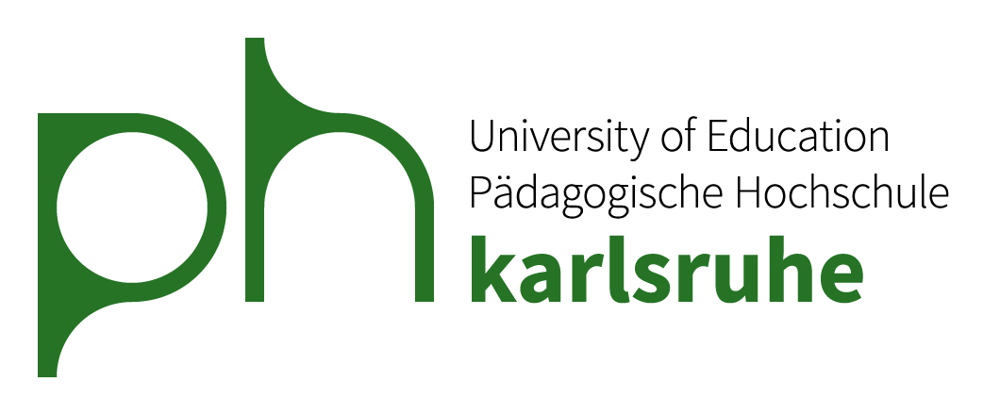

```{=html}
<div class="site-header">
  <div class="logos">
    
  </div>
</div>

<section class="hero">
  <div class="hero-text">
    <div class="eyebrow">Bachelor- und Masterarbeiten</div>
    <h1>Abschlussarbeitsthemen am Institut für Empirische Bildungsforschung</h1>
    <p>Freie Betreuungskapazitäten, aktuell angebotene Themen und Hinweise zu
    Betreuungsanfragen.</p>
  </div>
  <div class="hero-side">
    
    <div class="site-menu">
      <button class="menu-toggle" type="button" aria-label="Menü öffnen" aria-expanded="false" aria-controls="site-menu-list">
        <svg viewBox="0 0 24 24" width="28" height="28" aria-hidden="true"><path d="M3 6h18M3 12h18M3 18h18" stroke="currentColor" stroke-width="2" stroke-linecap="round" fill="none"/></svg>
      </button>
      <ul id="site-menu-list" class="menu-list" hidden>
        <li><a href="#" data-tab="0">Startseite</a></li>
        <li><a href="#" data-tab="1">Kapazitäten</a></li>
        <li><a href="#" data-tab="2">Aktuelle Themen</a></li>
        <li><a href="#" data-tab="3">Betreuungsanfrage</a></li>
      </ul>
    </div>
  </div>
</section>
```

::: {.panel-tabset}

## Startseite
Diese Seite richtet sich an Studierende der Pädagogischen Hochschule Karlsruhe und bietet 
eine Übersicht über die aktuell am Institut für Empirische Bildungsforschung (IfEB) angebotenen Abschlussarbeitsthemen.

::: {.callout-important}
## Hinweis
**Bitte beachten Sie:**

- Die Verfügbarkeit eines Themas sichert **nicht automatisch eine Betreuung** zu.
  Voraussetzung ist eine **persönliche Betreuungszusage**.
- Stellen Sie eine Betreuungsanfrage **nur für angebotene Themen**.
- Stellen Sie **Betreuungsanfragen nur wie beschrieben** unter "Betreuungsanfrage".
:::


```{=html}
<div class="cards">
  <a class="card-item" href="#" data-tab="1">
    <h3>Kapazitäten</h3>
    <p>Hier sehen Sie, ob aktuell Plätze für weitere Betreuungen frei sind.</p>
    <span class="card-arrow">Zu den Kapazitäten &rarr;</span>
  </a>
  <a class="card-item" href="#" data-tab="2">
    <h3>Aktuelle Themen</h3>
    <p>Derzeit angebotene Themen, filterbar nach Studiengang, Themenkategorie, Betreuung und Methode.</p>
    <span class="card-arrow">Zu den Themen &rarr;</span>
  </a>
  <a class="card-item" href="#" data-tab="3">
    <h3>Betreuungsanfrage</h3>
    <p>Informationen dazu, wie und mit welchen Angaben Sie eine Anfrage stellen.</p>
    <span class="card-arrow">Zur Anfrage &rarr;</span>
  </a>
</div>

<script>
// Reiter sind ausgeblendet; Karten, Menü und Zurück-Links schalten sie um.
document.addEventListener("DOMContentLoaded", function () {
  var toggle = document.querySelector(".menu-toggle");
  var list = document.getElementById("site-menu-list");
  var tabs = document.querySelectorAll(".panel-tabset > .nav-tabs .nav-link");

  function setMenu(open) {
    list.hidden = !open;
    toggle.setAttribute("aria-expanded", open);
  }

  function markActive(index) {
    list.querySelectorAll("a").forEach(function (a) {
      a.classList.toggle("active", parseInt(a.dataset.tab, 10) === index);
    });
  }

  toggle.addEventListener("click", function (e) {
    e.stopPropagation();
    setMenu(list.hidden);
  });
  document.addEventListener("click", function (e) {
    if (!e.target.closest(".site-menu")) setMenu(false);
  });
  document.addEventListener("keydown", function (e) {
    if (e.key === "Escape") setMenu(false);
  });

  document.addEventListener("click", function (e) {
    var link = e.target.closest("[data-tab]");
    if (!link) return;
    e.preventDefault();
    var tab = tabs[parseInt(link.dataset.tab, 10)];
    if (tab) {
      tab.click();
      setMenu(false);
      window.scrollTo({ top: 0, behavior: "smooth" });
    }
  });

  tabs.forEach(function (t, i) {
    t.addEventListener("shown.bs.tab", function () { markActive(i); });
  });
  markActive(0);
});
</script>
```


## Kapazitäten

```{=html}
<a class="back-link" href="#" data-tab="0">&larr; Zurück zur Startseite</a>
```

[Verfügbare Kapazitäten]{.section-title}

*Die Übersicht benötigt ggf. etwas Zeit zum Laden.*

```{=html}
<iframe src="https://copar.shinyapps.io/abschlussarbeiten-kapazitaeten/" title="Verfügbare Kapazitäten" loading="lazy" style="width:100%; height:450px; border:0;"></iframe>
```

```{=html}
<div class="next-nav">
  <a class="next-button" href="#" data-tab="2">Weiter zu Aktuelle Themen &rarr;</a>
</div>
```

## Aktuelle Themen

```{=html}
<a class="back-link" href="#" data-tab="0">&larr; Zurück zur Startseite</a>
```

[Aktuelle Themen]{.section-title}

*Die Übersicht benötigt ggf. etwas Zeit zum Laden.*

```{=html}
<iframe src="https://copar.shinyapps.io/abschlussarbeiten-themen/" title="Aktuelle Themen" loading="lazy" style="width:100%; height:900px; border:0;"></iframe>
```

```{=html}
<div class="next-nav">
  <a class="next-button" href="#" data-tab="3">Weiter zur Betreuungsanfrage &rarr;</a>
</div>
```

## Betreuungsanfrage

```{=html}
<a class="back-link" href="#" data-tab="0">&larr; Zurück zur Startseite</a>
```

[Eine Betreuungsanfrage stellen]{.section-title}

Sofern Kapazitäten vorhanden sind und Ihnen eines der Themen zusagt, senden Sie eine
Betreuungsanfrage per Email. Diese sollte Folgendes umfassen:

::: {.request-steps}
- Erst- oder Zweitbetreuungsanfrage?
- Welches Thema möchten Sie bearbeiten?
- Bachelor- oder Masterarbeit?
- In welchem Bearbeitungszeitraum möchten Sie die Arbeit anfertigen?
- Spezielle Vorkenntnisse (z. B. Mitarbeit in einem Forschungsprojekt mit größerer Fragebogenstudie, Besuch bestimmter Werkstätten am IfEB o. Ä.)?
:::

::: {.mail-button}
[Email an cora.parrisius\@ph-karlsruhe.de](mailto:cora.parrisius@ph-karlsruhe.de)
:::

:::
